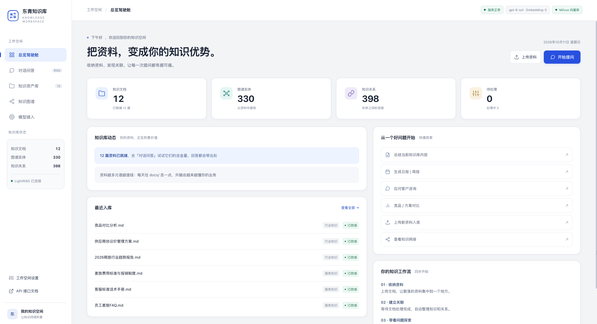
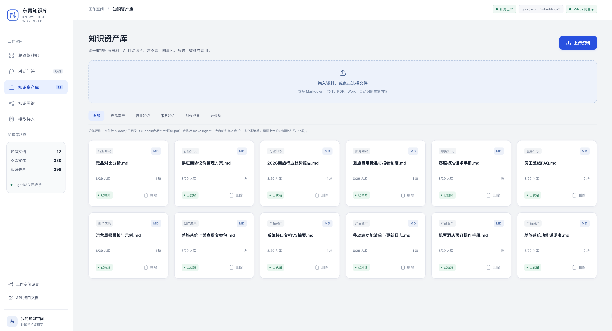
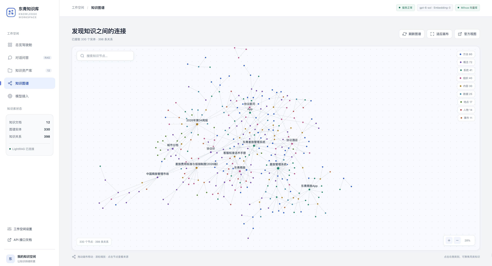

# 东青RAG知识库 · 企业级RAG知识库

用 **LightRAG（图谱 RAG）+ Milvus（向量库）+ 在线/本地大模型（可切换）** 搭的企业级个人/团队知识库。
文档入库后自动抽取实体关系构建知识图谱，提问时图谱与向量双路召回，回答带出处 —— 不只是"存资料"，而是让 AI 基于你的资料干活。

```
docs/ 文档 ──入库──> LightRAG（分块→实体关系抽取→向量化）
                         │                │
                  知识图谱(本地文件)    向量 → Milvus（默认内嵌 Lite，可切 Docker）
                                        │
提问 ──> 检索(mix/hybrid/local/global/naive) ──> 大模型(在线 GLM/DeepSeek/Qwen 或本地 Ollama) ──> 回答
```

**技术栈**：lightrag-hku 1.5.6 · Milvus Lite（pymilvus 3.x，零部署）· Python 3.12（uv 管理）

## 项目预览

### 总览驾驶舱

知识库统计、入库动态与快捷提问集中在一个工作台。



### 知识资产库

按分类管理资料，支持拖拽上传、处理状态展示和文档删除。



### 知识图谱

查看知识之间的关系，支持节点搜索、类别聚焦、拖动缩放与来源详情。



截图展示本机演示环境；仓库不包含截图中的测试文档、入库数据或分类清单。

---

## 一、快速开始（3 步）

```bash
make setup                      # ① 安装依赖（首次，需先安装 uv）
cp .env.example .env            # ② 复制配置，填入 API Key（默认智谱 GLM，glm-4-flash 免费）
make smoke                      # ③ 环境自检（不联网不耗 Token）
make ingest                     #    将自己的文档放入 docs/ 后执行（首次会下载 tiktoken 词表）
make query Q="这个知识库怎么帮我干活？"
./start_server.sh               # 启动 WebUI：http://127.0.0.1:9621
```

**申请 API Key（默认预设：智谱 GLM，一个 Key 同时提供对话+向量模型）**
到 [open.bigmodel.cn](https://open.bigmodel.cn) 注册后在「API Keys」创建即可；`glm-4-flash` 免费额度，零成本跑通。

## 二、日常使用

| 命令 | 作用 |
|---|---|
| `make ingest` | 入库 `docs/` 全部文档（支持 .md .txt .pdf .docx，内容相同自动去重） |
| `make ingest DIRS='docs 报告'` | 入库指定目录/文件 |
| `make query Q="问题"` | 单次提问 |
| `make query Q="..." MODE=--stream` | 流式输出（把 `scripts/query.py` 直接跑也行，支持 `--mode local` 等） |
| `make chat` | 多轮对话模式（带上下文，输入 q 退出、`--` 清历史） |
| `make server` | 启动 WebUI 知识库工作台（http://127.0.0.1:9621） |
| `make clean` | 清空知识库数据（换向量模型时必须先做） |

**WebUI 中文工作台**：启动后浏览器打开 <http://127.0.0.1:9621>。浅灰背景、白色卡片和蓝色强调色，提供五个视图：**总览驾驶舱**（统计卡片、知识库动态、最近入库、快捷指令）、**对话问答**（流式回答、引用来源、检索模式）、**知识资产库**（分类标签、文档卡片、拖拽上传、处理状态）、**知识图谱**（自研 Canvas 力导向布局、标签避让、搜索、类别聚焦、缩放、节点来源详情）、**模型接入**（在线 / 本地模型配置，内置智谱、DeepSeek、通义、OpenAI、Ollama 预设）。原生英文 WebUI 保留在 `/webui`。

公开仓库只提供代码、配置模板和项目截图。`docs/` 中的知识库资料、`data/` 中的入库数据和生成的分类清单均不纳入版本控制；使用时上传自己的资料即可。`make server` 等服务管理命令依赖本机已配置的 macOS LaunchAgent，新克隆的项目可先用 `./start_server.sh` 启动。

**命令行提问模式**：`--mode mix`（默认，图谱+向量混合，综合最优）/ `local`（具体细节）/ `global`（宏观概况）/ `hybrid`（图谱双路）/ `naive`（纯向量）/ `--context`（只看检索到什么资料，不生成回答，调试用）。

## 三、切换模型：在线 ⇄ 本地

全部在 `.env` 里改，`make smoke` 验证后重启服务/重跑脚本即可。`.env.example` 里每个供应商都是现成的预设块（智谱 GLM、DeepSeek+硅基流动、通义 Qwen、OpenAI、本地 Ollama），**把想用的那块的注释去掉即可**。

- **换对话模型（LLM）**：随时换，无副作用。
- **换向量模型（Embedding）**：向量维度会变，⚠️ 必须先 `make clean` 清库再重新入库，否则检索错乱。
- **切本地 Ollama**：先 [安装 Ollama](https://ollama.com)，`ollama pull qwen3:8b && ollama pull bge-m3`，然后启用 `.env` 第④块。要求 16G+ 内存，实体抽取速度比在线模型慢，建议 `LLM_BINDING_MAX_ASYNC=2`。

## 四、向量库：Milvus Lite ⇄ Docker 版

默认 **Milvus Lite**：向量库就是一个本地文件 `data/milvus_lite.db`，零安装零运维，个人知识库完全够用。

数据量大（十万+ 分块）或要多机/多服务共享时，切 Docker 版：

```bash
make milvus-up    # 启动 Milvus standalone（localhost:19530，账号 root / Milvus）
# 编辑 .env：注释掉「方式A」的 MILVUS_URI=./data/milvus_lite.db，
#            打开「方式B」的 MILVUS_URI=http://localhost:19530
make smoke && make ingest
```

## 五、把知识库挂进你的工作流（"外脑"玩法）

`make server` 启动后即是一套 REST 服务（完整接口清单见 Swagger：http://127.0.0.1:9621/docs ）：

```bash
# 提问
curl -X POST http://127.0.0.1:9621/query \
  -H "Content-Type: application/json" \
  -d '{"query": "客户的退货流程是什么？", "mode": "mix"}'

# 流式
curl -X POST http://127.0.0.1:9621/query/stream \
  -H "Content-Type: application/json" \
  -d '{"query": "本周待办有哪些？", "mode": "mix", "stream": true}'

# 直接丢文本入库
curl -X POST http://127.0.0.1:9621/documents/text \
  -H "Content-Type: application/json" \
  -d '{"text": "会议纪要内容……", "description": "周会纪要"}'
```

参考"落地四环节"的玩法：
- **智能客服/机器人**：把 `/query` 接进你的客服流程，知识库回答不准时转人工；
- **定时任务**：用 cron/自动化工具定时 `curl /query` 生成日报、周报、跟进提醒；
- **挂到其他 AI 工具**：任何支持自定义 OpenAI/Ollama 接口的客户端，都能把本知识库当"外脑"数据源（用 `/query` 取上下文再喂给主模型）。
- 给 API 加口令：`.env` 里打开 `LIGHTRAG_API_KEY`（云端/局域网部署建议开启）。

## 六、目录结构

```
知识库/
├── .env                  # 你的配置（从 .env.example 复制，填 Key）
├── .env.example          # 配置模板（5 个供应商预设 + 存储配置）
├── requirements.txt
├── Makefile              # make setup/ingest/query/chat/server/smoke
├── start_server.sh       # WebUI 启动脚本
├── docker-compose.milvus.yml   # 可选：Docker 版 Milvus
├── app/
│   ├── rag_factory.py    # 核心：读 .env 构建 LightRAG（模型切换逻辑都在这）
│   └── webui_cn/         # 自研中文工作台（对话 + 文档管理 + 指南）
├── scripts/
│   ├── ingest.py         # 批量入库（md/txt/pdf/docx）
│   ├── query.py          # 命令行问答/多轮对话
│   ├── run_server.py     # WebUI 启动包装（处理 pymilvus 的 MILVUS_URI 导入期校验）
│   └── smoke_test.py     # 环境自检（不联网）
├── assets/screenshots/   # README 项目截图
├── tests/                # 前端图谱与交互回归测试（不含业务测试资料）
├── docs/                 # ← 放入自己的知识库资料（不提交到仓库）
└── data/
    ├── rag_storage/      # 知识图谱、分块缓存、文档状态
    └── milvus_lite.db    # Milvus Lite 向量库文件（备份它=备份向量数据）
```

## 七、常见问题

- **报 401 / API Key 无效**：确认 `.env` 里 Key 填对了供应商的（智谱 Key 别填到 DeepSeek 预设）。
- **启动报 `Illegal uri: [...] expected form http[s]://`**：把本地文件路径填进了 `MILVUS_URI`。Lite 模式请保持 `MILVUS_URI` 留空，文件路径写在 `MILVUS_LITE_PATH`（pymilvus 2.6+ 会在导入时强制校验该变量为 http 地址，这是它的行为，不是配置错误）。
- **/health 里 vector_storage 显示 NanoVectorDBStorage**：说明 `LIGHTRAG_VECTOR_STORAGE` 没配好（`.env.example` 模板已包含，别删）。
- **报向量维度不匹配**：`EMBEDDING_DIM` 必须等于向量模型的真实输出维度（智谱 embedding-3=2048，bge-m3=1024，qwen text-embedding-v4=1024，OpenAI text-embedding-3-small=1536）。换过模型后要 `make clean` 重灌。
- **入库卡住/很慢**：第一次入库要抽实体+向量化，属于正常耗时；批量大的话调大 `MAX_PARALLEL_INSERT`（在线模型 2~4）。
- **检索结果不相关**：调 `.env` 的 `COSINE_BETTER_THAN_THRESHOLD`（默认 0.2，越小召回越宽松）；或换 `--mode` 试试。
- **Ollama 抽取乱/截断**：确认 `OLLAMA_NUM_CTX`≥32768（工厂默认已设置）。
- **想彻底重来**：`make clean`（或直接删 `data/` 目录）。
- **WebUI 里文档显示「失败」**：多半是 `.env` 还没填 API Key 时触发了入库。填好 Key 后 `make server` 重启即自动重试；或在原生 WebUI（/webui）里对失败文档点重新处理。
- **服务打不开**：`make server-log` 看日志；`make server` 强制重启。服务是系统服务（LaunchAgent `com.ragkb.server`），开机自动运行，不依赖任何终端。

> 提示：本项目的真实文件都存放在 `~/.ragkb/`（`code/`=代码与配置、`venv/`=环境、`data/`=知识库数据），项目文件夹里看到的都是软链 —— 因为 macOS 的「文档」文件夹被 iCloud 同步，虚拟环境/数据库/服务进程放里面会被同步拖慢甚至卡死。**你正常在项目文件夹里编辑文件即可（软链是双向的）**；Web 服务由 macOS 系统服务托管（开机自启、崩溃自动拉起），`make server` 重启、`make server-log` 看日志。
